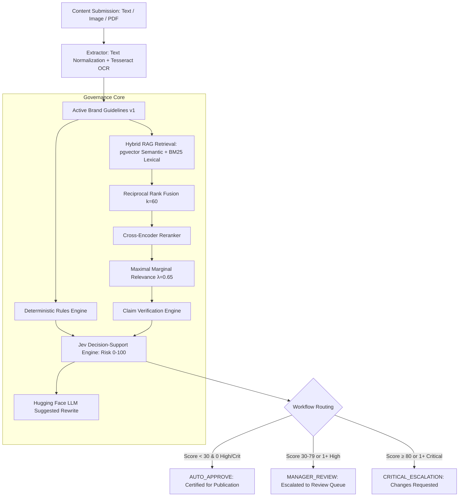

# INKLOOM AI — Brand Governance & Compliance Platform

**Tagline:** Create freely. Govern intelligently. Publish confidently.

---

## 1. Executive Summary & Problem Solved

Enterprises face immense legal, reputational, and brand-equity risks when publishing marketing copy, digital graphics, and corporate PDF whitepapers across distributed teams. Common violations include:
- Unsubstantiated absolute claims (e.g., *"guaranteed 100% uptime"*, *"mathematically unhackable"*).
- Missing mandatory regulatory and SLA disclaimers.
- Inconsistent trademark nomenclature and unapproved terminology.
- Factual claims that contradict official corporate specifications and compliance handbooks.

**INKLOOM AI** solves this with an end-to-end Brand Governance Platform. It ingests submissions across **Text, Images (with Tesseract.js OCR)**, and **PDF documents**, audits them through a multi-stage **Hybrid RAG Pipeline**, evaluates deterministic policy rules, verifies factual claims against approved knowledge chunks, calculates an explainable **Jev Compliance Score (0-100)**, and routes the submission through an authorized human review workflow.

---

## 2. System Architecture

INKLOOM AI is structured into two clean, decoupled services with strict tenant isolation:

```
inklooM/
├── frontend/               # Next.js (App Router, React, JavaScript, Tailwind CSS)
│   ├── src/
│   │   ├── app/            # Public landing, Auth, Dashboard, Submissions, Manager, Admin
│   │   ├── components/     # Persistent Sidebar, Layout, Personas
│   │   ├── context/        # Auth & Role switching context
│   │   └── lib/            # REST API client
│   └── package.json
│
├── backend/                # Node.js + Express (Pure JavaScript)
│   ├── src/
│   │   ├── config/         # Environment, Supabase, and Hugging Face client
│   │   ├── middleware/     # Tenant isolation & RBAC authorization
│   │   ├── routes/         # Submissions, Reviews, Guidelines, Knowledge, Admin
│   │   ├── services/
│   │   │   ├── extractor.js       # Text, Image OCR (Tesseract.js), PDF extraction
│   │   │   ├── rulesEngine.js     # Deterministic brand policy checks
│   │   │   ├── rag/               # Hybrid RAG (pgvector + Lexical BM25 + RRF + Cross-Encoder + MMR)
│   │   │   ├── jevEngine.js       # Jev decision-support & risk scoring (0-100)
│   │   │   ├── claimVerifier.js   # Factual alignment & policy contradiction detection
│   │   │   ├── llmExplainer.js    # Hugging Face LLM explanations & compliant rewrite
│   │   │   └── dataStore.js       # Transactional store with Supabase synchronization
│   │   ├── test/                  # Unit test suite for Rules, RRF, MMR, Jev scoring
│   │   └── server.js              # Express API server
│   └── package.json
│
└── supabase/
    ├── migrations/         # PostgreSQL schema, pgvector, full-text tsvector, RLS policies
    └── seed.sql            # Realistic demo data for "Aetheris Dynamics"
```

---

## 3. The 5-Stage Governance Pipeline



### 1. Unified Content Ingestion & OCR
- **Direct Text**: Normalizes whitespace, strips control characters, preserves paragraph breaks.
- **Images (PNG, JPG, JPEG)**: Visible text is extracted using pure-JS/WASM `tesseract.js` OCR. Computes confidence and source kind `ocr`.
- **PDF Documents**: Embedded text is extracted with page-number offsets. Scanned pages are flagged for OCR fallback.

### 2. Deterministic Rules Engine
- Evaluates text against the active versioned brand guideline.
- Matches prohibited terms using case-insensitive word-boundary regex.
- Flags ungrounded superlatives (e.g. *"best in the world"*).
- Enforces mandatory disclaimers triggered by contextual topics (e.g. uptime/SLA triggers the SLA disclaimer; robotics/autonomous triggers the supervisor oversight disclaimer).
- Recommends approved brand terminology.

### 3. Hybrid RAG Pipeline
- **Semantic Vector Retrieval**: 384-dimensional dense vectors generated via Hugging Face `all-MiniLM-L6-v2` (with deterministic local fallback).
- **Lexical Keyword Retrieval**: PostgreSQL `tsvector` ranked search with term frequency and exact phrase matching bonus.
- **Reciprocal Rank Fusion (RRF)**: Fuses both candidate channels using:
  $$\text{RRF}(d) = \sum \frac{1}{k + \text{rank}_i(d)} \quad (k = 60)$$
- **Cross-Encoder Reranking**: Re-orders top fused candidates using cross-token semantic alignment.
- **Maximal Marginal Relevance (MMR)**: Selects non-redundant, diverse evidence chunks using:
  $$\text{MMR} = \lambda \cdot \text{relevance} - (1 - \lambda) \cdot \max_{s \in S} \text{Sim}(d, s) \quad (\lambda = 0.65)$$

### 4. Claim Verification & Factual Alignment
- Compares claims against retrieved corporate reference chunks.
- Distinguishes:
  - `VERIFIED_CONSISTENT`: Claim directly substantiated by corporate factsheet.
  - `CONTRADICTS_POLICY`: Explicit contradiction with established SLAs or safety standards.
  - `UNVERIFIED_CLAIM`: Statement unsupported by approved knowledge base.

### 5. Jev Decision-Support & Risk Scoring
- Assigns severity-weighted risk contributions: `CRITICAL` (40 pts), `HIGH` (25 pts), `MEDIUM` (12 pts), `LOW` (4 pts).
- Calculates total compliance risk (0 to 100).
- Categorizes risk tier: `LOW` (0-29), `MEDIUM` (30-59), `HIGH` (60-79), `CRITICAL` (80-100).
- Determines explainable routing: `AUTO_APPROVE`, `MANAGER_REVIEW`, or `CRITICAL_ESCALATION`.
- Generates an advisory suggested compliant rewrite via Hugging Face LLM (with rule-grounded offline fallback).

---

## 4. Multi-Company Tenant Isolation & RBAC

INKLOOM AI implements strict multi-company tenancy:
- Every table (`submissions`, `revisions`, `guidelines`, `knowledge_documents`, `knowledge_chunks`, `reviews`, `audit_logs`) has a `company_id` foreign key.
- Supabase Row-Level Security (RLS) ensures users can only read their authorized company's records.
- Three strictly separated roles:
  1. `USER`: Can create submissions, view their own analysis reports, and resubmit revisions. Cannot view other users' submissions or modify guidelines.
  2. `MANAGER`: Can audit company submissions in the review queue and record `APPROVED`, `REJECTED`, or `CHANGES_REQUESTED` decisions with mandatory feedback.
  3. `ADMIN`: Can publish new brand guideline versions, ingest reference documents, inspect audit trails, and manage company memberships. Cannot override manager reviews simply because they are Admin.

---

## 5. Quick Start & Local Execution

### Prerequisites
- Node.js v18+ (tested on Node v24)
- npm v9+

### 1. Run the Backend API Service
```bash
cd backend
npm install
npm test          # Runs all 9 unit tests for Rules, RRF, MMR, and Jev Scoring
npm start         # Starts backend API on http://localhost:5000
```

### 2. Run the Next.js Frontend Application
In a separate terminal:
```bash
cd frontend
npm install
npm run dev       # Starts Next.js App on http://localhost:3000
```

Open [http://localhost:3000](http://localhost:3000) in your browser.

---

## 6. Demo Personas for Evaluators & Judges

A persona switcher is available in the sidebar and login screen to evaluate different roles instantly:

| Role | Name | Email | Primary Responsibilities |
|---|---|---|---|
| **USER** | Elena Rostova | `user@aetheris.com` | Content Submissions, Review Workspace, Revision Resubmits |
| **MANAGER** | Marcus Vance | `manager@aetheris.com` | Review Queue, Risk Approvals, Change Requests with Mandatory Comments |
| **ADMIN** | Dr. Sarah Lin | `admin@aetheris.com` | Brand Guidelines Versioning, Knowledge Fact Ingestion, Audit Logs |

---

## 7. Environment Variables Configuration

### Backend (`backend/.env`)
```ini
PORT=5000
NODE_ENV=development

# Supabase (Optional for local test; in-memory store acts as instant fallback)
SUPABASE_URL=https://your-project.supabase.co
SUPABASE_ANON_KEY=your-supabase-anon-key
SUPABASE_SERVICE_ROLE_KEY=your-supabase-service-key

# Hugging Face Inference API (Optional; deterministic local fallbacks included)
HUGGINGFACE_API_KEY=hf_your_key_here
HUGGINGFACE_EMBEDDING_MODEL=sentence-transformers/all-MiniLM-L6-v2
HUGGINGFACE_RERANKER_MODEL=cross-encoder/ms-marco-MiniLM-L-6-v2
HUGGINGFACE_LLM_MODEL=meta-llama/Llama-3.2-3B-Instruct

INTERNAL_API_SECRET=inkloom-internal-secret-change-in-prod
MAX_FILE_SIZE_MB=10
```

### Frontend (`frontend/.env.local`)
```ini
NEXT_PUBLIC_BACKEND_URL=http://localhost:5000
```

---

## 8. Deployment Guide (Render & Supabase)

### Deploying to Render
1. **Backend Web Service**:
   - Environment: Node
   - Root Directory: `backend`
   - Build Command: `npm install`
   - Start Command: `node src/server.js`
   - Port: `5000`
2. **Frontend Web Service**:
   - Environment: Node
   - Root Directory: `frontend`
   - Build Command: `npm install && npm run build`
   - Start Command: `npm start`
   - Environment Variable: `NEXT_PUBLIC_BACKEND_URL=https://your-backend-service.onrender.com`

### Supabase Database Migration
1. Go to your Supabase Project SQL Editor.
2. Run the migration script in `supabase/migrations/20261028_init_schema.sql`.
3. Run the seed script in `supabase/seed.sql`.
